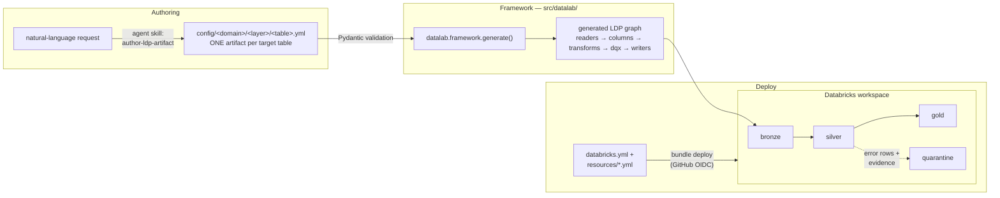
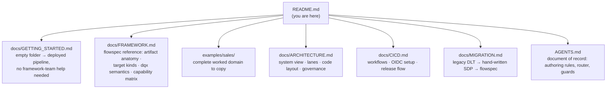
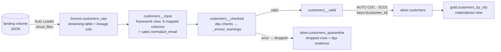

# datalab

**Config-driven Lakeflow framework for the medallion lakehouse.** Every
target table is ONE YAML artifact — authored by a human or a coding agent,
validated by Pydantic, generated into **Lakeflow Spark Declarative Pipelines**
(`pyspark.pipelines`), quality-checked end to end with
[databrickslabs/dqx](https://databrickslabs.github.io/dqx/), and deployed to
Databricks as a **Declarative Automation Bundle** with GitHub-OIDC CI/CD.

> AI coding agents and humans: the document of record is **[AGENTS.md](AGENTS.md)**.
> Read it before editing.

## Architecture at a glance



Three invariants hold everywhere:

- **One artifact per table.** Columns (source→target names + types), dqx
  rules, transforms and target kind live in a single YAML file. No `dlt`,
  no hand-wired `dp` calls.
- **Rows are never silently dropped.** Every error-criticality rule
  auto-creates `<table>_quarantine` with `_errors` evidence structs.
- **No hardcoded catalogs — ever.** Every location is a pipeline-conf key
  resolved per environment through bundle variables; promoting
  dev → stage → prod never edits a config file.

## Documentation map



| Doc | Read it when |
|---|---|
| [docs/GETTING_STARTED.md](docs/GETTING_STARTED.md) | you are building a pipeline on the framework — empty folder → deployed pipeline, no framework-team help needed |
| [docs/FRAMEWORK.md](docs/FRAMEWORK.md) | you are adding a table or domain: artifact schema, generated graph, target kinds, data-quality semantics, the SDP capability matrix |
| [examples/sales/](examples/sales/README.md) | you want a finished example to copy — complete worked domain, mirrors an adopter repo |
| [docs/ARCHITECTURE.md](docs/ARCHITECTURE.md) | you need the system picture: CI/CD → workspace resources, the three authoring lanes, code organization, environments, RBAC/ABAC |
| [docs/CICD.md](docs/CICD.md) | you are wiring a target or debugging a deploy: workflows, federation policies, GitHub Environments, release flow |
| [docs/MIGRATION.md](docs/MIGRATION.md) | you knew the legacy/intermediate codebase and need the old → current concept map |
| [AGENTS.md](AGENTS.md) | always, before editing — routing rules, protected files, PR conventions |

## Repository map

| Surface | Where | What |
|---|---|---|
| Framework | `src/datalab/` | the ONLY package under `src/` — REUSABLE, zero domain code: Pydantic models, LDP generator, dqx engine, devtools, param helpers |
| Reference domains | `examples/` (currently `sales/`) | complete worked adoptions, each mirroring an adopter repo root — copy one to start your own domain |
| Dataset configs | `examples/sales/config/sales/` (adopters: `config/<domain>/`) | ONE artifact per target table: column mappings + types, dqx rules, target kind |
| Domain code | `examples/sales/src/sales_etl/` (adopters: `src/<domain>_etl/`) | pure `@transform` functions, custom dqx checks, 3-line pipeline entrypoint |
| Edge lanes | `examples/sales/src/jobs/sales/` + `examples/sales/notebooks/sales/` | python-file lane (headless exports) + notebook lane (human-gated triage) |
| Deploy | `databricks.yml` + `examples/*/resources/` (adopters: `resources/`) | bundle variables, targets `dev`/`stage`/`prod`, pipeline + jobs |
| Tests | `tests/` (framework, example-free) + `examples/sales/tests/` | unit tests on a local SparkSession — no workspace needed |
| CI/CD | `.github/` | ruff + pytest + config validation + `bundle validate` on PRs; OIDC deploys on merge/tags |
| Agent harness | `.claude/`, `.cursor/`, `.githooks/` | rules, skills, PR-template + protected-file guards |
| Docs | `docs/` | the child docs mapped above |

## Quick start

```bash
# prereqs: uv, Java 17+ (local Spark), Databricks CLI >= v0.294.0
make install            # uv sync → .venv from uv.lock
make enable-githooks    # protected-files pre-commit guard
make validate-configs   # validate every domain's YAML artifacts (pydantic + dqx)
make lint test          # ruff + pytest (framework suite + example suites)

databricks auth login --host https://dbc-425be768-f138.cloud.databricks.com
make validate           # bundle validate -t dev
make deploy             # deploy to dev (resources prefixed [dev <you>])
make run                # refresh the sales_etl example pipeline

databricks bundle run sales_export -t dev             # python-file lane example
databricks bundle run sales_quarantine_report -t dev  # notebook lane example
```

`make help` lists everything. The full release flow (dev on merge,
stage on `v*-rc*` tags, prod on `v*` tags) is in
[docs/CICD.md](docs/CICD.md#release-flow).

## The sales example, end to end

The reference pipeline is generated entirely from
`examples/sales/config/sales/<layer>/<table>.yml` artifacts (an adopter repo
keeps the same tree at `config/<domain>/`):



Adding your own table is one artifact + (rarely) one pure `@transform`
function — the walkthrough is in
[docs/FRAMEWORK.md](docs/FRAMEWORK.md#add-a-table--one-artifact);
[docs/GETTING_STARTED.md](docs/GETTING_STARTED.md) takes a brand-new domain
from empty folder to deployed pipeline.

## Dependencies (uv)

`pyproject.toml` is the single source of truth; `uv.lock` is committed and CI
installs with `uv sync --frozen`.

```bash
$EDITOR pyproject.toml && make lock && make install
```

## Branching, PRs, releases

Branch from `main` (`feature/…`, `fix/…`, `debug/…`); one PR per branch using
the unified template (marker `datalab-pr-template` — hook + CI enforce it);
head branches are **deleted automatically on merge**. Merge to `main`
deploys dev; `vX.Y.Z-rcN` tags deploy stage; `vX.Y.Z` tags deploy prod.

```bash
cp .github/pull_request_template.md /tmp/pr-body.md   # fill it in
gh pr create --title "..." --body-file /tmp/pr-body.md
```
