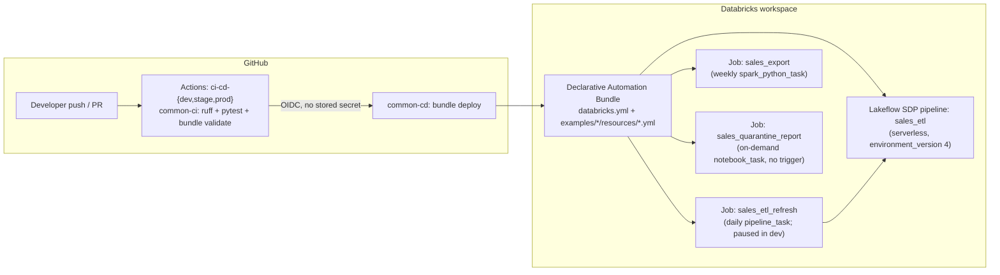
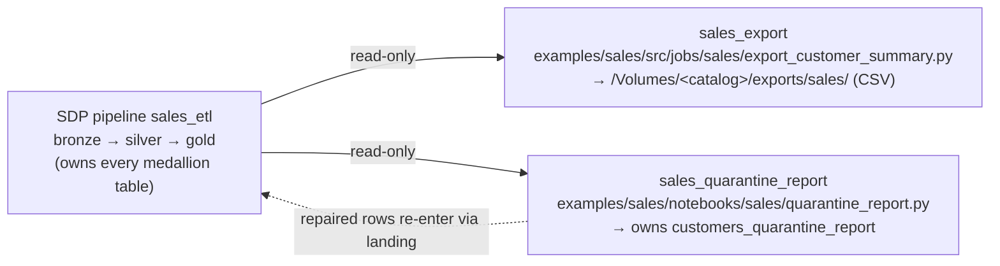
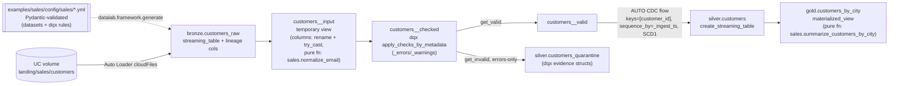

# Architecture

## System view

## Three authoring lanes

The SDP pipeline owns **all medallion tables** (single-writer invariant); jobs
work the lakehouse edges and only read pipeline-owned tables:

Routing is the 3-question router in AGENTS.md ("Authoring rules"): managed
medallion Delta table → SDP (mandatory, backfills via `backfill:` once-flows
in the artifact); headless side-effectful edge work → python-file
(`spark_python_task`); human-gated runs → notebook (`notebook_task`, no
trigger).

## Data view (medallion, generated from the sales example's artifacts)

Authoring model: developers edit YAML (datasets, transforms by registry name,
dqx checks) — `docs/FRAMEWORK.md` is the reference (including fan-in
`sources:`, `backfill:` once-flows, snapshot CDC, kafka in/out, and the SDP
capability matrix). The framework (`src/datalab/framework/`) validates
configs with Pydantic at pipeline import and registers every LDP object
through reader/writer adapters; data quality is databrickslabs/dqx end to end.

## Code organization

Layers, deliberately separated:

1. **`src/datalab/`** — THE framework, the only package under `src/`
   (installed into the pipeline and job environments via
   `--editable ${workspace.file_path}`). Models, adapters, generator,
   devtools, param helpers. Unit-testable with a local SparkSession
   (`tests/`, example-free).
2. **`examples/<domain>/`** — complete reference domains, each mirroring an
   adopter repo root (`examples/README.md` has the mapping table). Inside
   one domain:
   - `config/<domain>/` — the YAML artifacts (the pipeline definition);
   - `src/<domain>_etl/` — the 3-line pipeline entrypoint + pure
     `@transform` functions + custom dqx checks;
   - `src/jobs/<domain>/` — python-file lane entry points
     (`spark_python_task`): argparse + explicit `main()`, side effects
     allowed, thin wiring;
   - `notebooks/<domain>/` — notebook lane (`notebook_task`): human-gated,
     on-demand, widgets mirroring job parameters, no business logic in cells;
   - `resources/` — the domain's bundle resources (relative paths, so the
     folder transplants to an adopter repo unchanged);
   - `tests/` — the domain's own unit + contract tests.

Parameterization, one fail-fast contract per lane, no hardcoding anywhere:
bundle variables → pipeline `configuration:` → `pipeline_conf(spark, key)`
(SDP); bundle variables → job `parameters:` → `base_parameters` widgets →
`datalab.params.notebook_params` (notebook) or task argv flags →
`datalab.params.cli_params` (python-file).

Quality: dqx checks defined per dataset in the layer YAML. The same list
drives the target's valid-row filter and the quarantine table, so the two can
never diverge; evidence lands as `_errors`/`_warnings` structs.

## Environments

| Target | Mode | Catalog (default) | Trigger state |
|---|---|---|---|
| dev | development (prefixed, isolated per user) | `customer_sales` | paused |
| stage | production | `customer_sales_stage` | live |
| prod | production | `customer_sales_prod` | live |

## Access governance (RBAC / ABAC)

Three layers, each with one home:

1. **Workspace-resource RBAC** (who can run/manage the pipeline and jobs):
   `permissions:` on every resource, driven by the `reader_group` /
   `engineer_group` string variables in `databricks.yml`. They diverge per
   target (dev uses demo groups; stage/prod use the `dl_sales_*` persona
   groups) and per GitHub Environment (`DATALAB_READER_GROUP` /
   `DATALAB_ENGINEER_GROUP` repo variables → `deploy-dab` `--var`).
2. **Unity Catalog RBAC** (who can read/write the data): grants-as-code in
   `scripts/bootstrap_uc.py` — idempotent catalog/schema/volume DDL + GRANTs,
   applied once per target with `make bootstrap-uc`. Deliberately out-of-band
   of the bundle so `bundle destroy` never touches governance state. Readers
   get silver/gold SELECT + export-volume reads; engineers get medallion
   build rights; bronze/landing stay engineer-only.
3. **ABAC** (row/column-level): column masks and row filters under the
   domain's `sql/abac/` folder (this repo:
   `examples/sales/sql/abac/`). Display-only by convention — agents and CI
   never execute them; an admin reviews and applies. SDP does offer a
   pipeline-level `row_filter`/column-mask surface (Public Preview); this
   repo deliberately does not use it — access policy stays admin-applied,
   out of the deploy path. Allowed constructs:
   `CREATE FUNCTION ... RETURN`, `ALTER TABLE ... SET MASK / SET ROW FILTER`,
   `is_account_group_member()`, `current_user()`. Re-runnable, function
   before ALTER, named `dl_mask_<purpose>` / `dl_rf_<purpose>`. Worked
   example: `examples/sales/sql/abac/mask_customer_email.sql`.

Group creation stays account/workspace-level (`databricks groups create`) —
nothing in this repo creates principals.

Keep this document in sync with reality — it is part of the protected
documents-of-record surface (see AGENTS.md).
