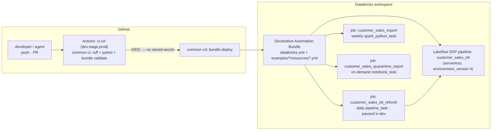
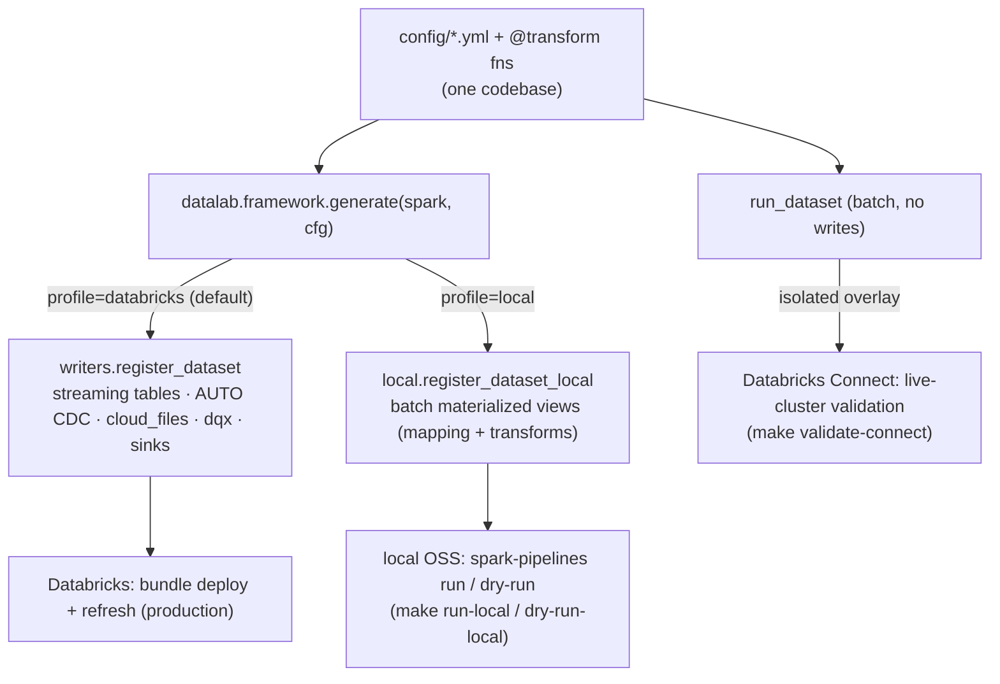
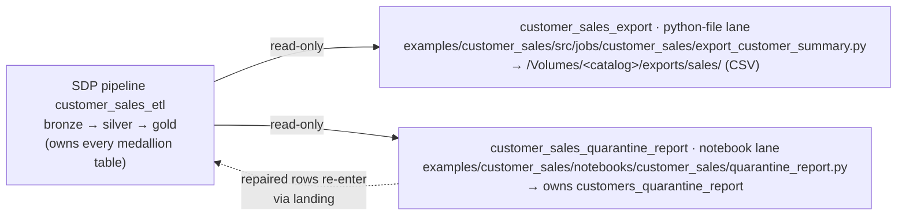
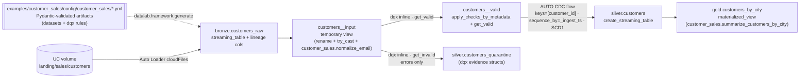
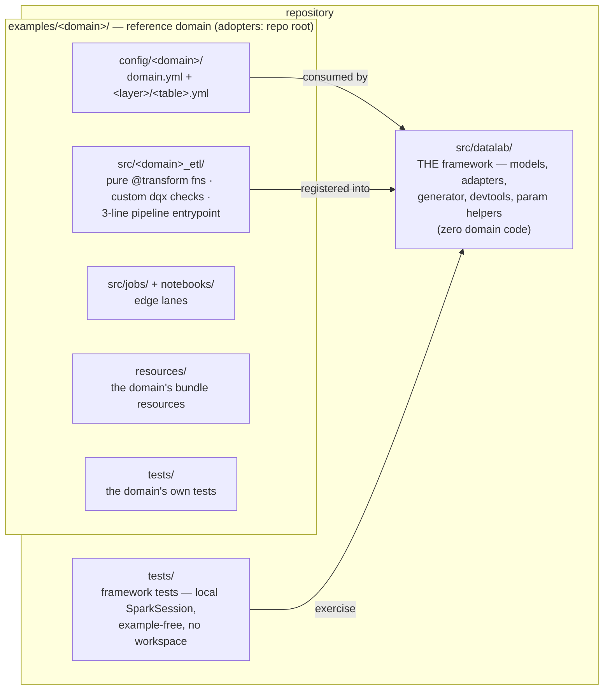
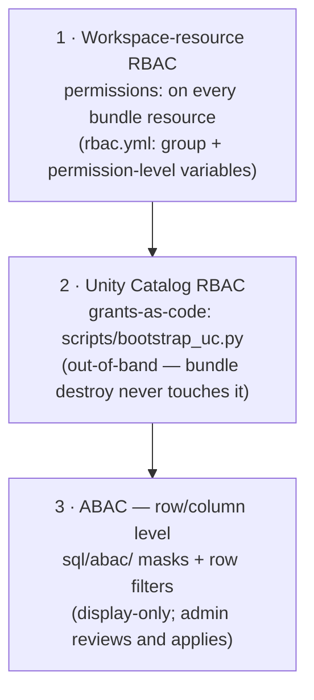

# Architecture

[← README](../README.md) · **Architecture** · [Framework](FRAMEWORK.md) · [CI/CD](CICD.md) · [Migration](MIGRATION.md)

How datalab hangs together: from a GitHub push to running Lakeflow resources,
the three authoring lanes, the medallion data view, code organization, and
governance.

> Editable architecture diagrams (diagrams.net / draw.io) live in `design/` —
> see [Editing the design diagrams](#editing-the-design-diagrams) for how to
> open, edit, validate, and keep them in sync with the code.

## System view



The bundle is the only thing that touches the workspace. CI validates it on
every PR; CD deploys it on merge (dev) and tags (stage/prod) — details in
[CICD.md](CICD.md).

## Execution profiles (run anywhere)

One config-driven codebase runs three ways; `datalab.profile` (a pipeline
`configuration` value, default `databricks`) selects the graph. Only the
Databricks profile is the deploy/production path — the other two are local
development aids. Details + fidelity caveats: [FRAMEWORK.md](FRAMEWORK.md)
"Run anywhere".



- **Databricks** — the bundle deploys the full Lakeflow graph; the only profile
  that runs AUTO CDC, Auto Loader, dqx quarantine and sinks for real.
- **Local OSS** (`datalab.framework.local`) — downgrades to a batch
  materialized-view graph the `spark-pipelines` CLI runs on sample data; no
  AUTO CDC dedup / dqx / Auto Loader (OSS SDP can't express them).
- **Databricks Connect** — runs one dataset's mapping/transforms/dqx via
  `run_dataset` on a live cluster from an isolated, out-of-lock overlay.

## Three authoring lanes

The SDP pipeline owns **all medallion tables** (single-writer invariant).
Jobs work the lakehouse edges and only *read* pipeline-owned tables:



Routing is the 3-question router (AGENTS.md, "Authoring rules"):

| New target is… | Lane | Mechanism |
|---|---|---|
| a managed medallion Delta table | **SDP via YAML config** (mandatory) | `config/<catalog>/<schema>/<table>.yml`; backfills via `backfill:` once-flows |
| headless, side-effectful edge work | **python-file** | `spark_python_task`: argparse + explicit `main()` |
| human-must-decide | **notebook** | `notebook_task`, no trigger; widgets mirror job parameters |

## Data view (medallion, generated from the customer_sales example's artifacts)



Developers (and agents) edit YAML only; the framework validates configs with
Pydantic at pipeline import and registers every LDP object through
reader/writer adapters; data quality is databrickslabs/dqx end to end. The
artifact schema and semantics — including fan-in `sources:`, `backfill:`
once-flows, snapshot CDC, kafka in/out, and the SDP capability matrix — are
in [FRAMEWORK.md](FRAMEWORK.md).

## Code organization



Layer rules, deliberately separated:

1. **`src/datalab/`** — THE framework, the only package under `src/`
   (installed into the pipeline and job environments via
   `--editable ${workspace.file_path}`). Models, adapters, generator,
   devtools, param helpers; never contains domain code or hardcoded domain
   module paths. Unit-testable locally (`tests/`, example-free).
2. **`examples/<domain>/`** — complete reference domains, each mirroring an
   adopter repo root (`examples/README.md` has the mapping table): the YAML
   artifacts (`config/<domain>/`), the domain package (`src/<domain>_etl/`),
   the edge-lane entry points (`src/jobs/<domain>/`, `notebooks/<domain>/`),
   the domain's bundle `resources/` (relative paths, so the folder
   transplants to an adopter repo unchanged), and its own `tests/`.
3. **Parameterization, one fail-fast contract per lane**, no hardcoding
   anywhere: bundle variables → pipeline `configuration:` →
   `pipeline_conf(spark, key)` (SDP); bundle variables → job `parameters:` →
   widgets → `datalab.params.notebook_params` (notebook) or argv flags →
   `datalab.params.cli_params` (python-file).

Quality: dqx checks are defined per dataset in the layer YAML. The same list
drives the target's valid-row filter and the quarantine table, so the two can
never diverge; evidence lands as `_errors`/`_warnings` structs.

## Environments

| Target | Mode | Catalog (default) | Trigger state |
|---|---|---|---|
| dev | development — resources prefixed `[dev <user>]`, isolated per user | `customer_sales` | paused |
| stage | production | `customer_sales_stage` | live |
| prod | production | `customer_sales_prod` | live |

Catalogs and schemas are bundle variables; the same artifacts deploy to all
three targets unchanged.

## Access governance (RBAC / ABAC)

Three layers, each with one home:



- **Layer 1** controls who can run/manage pipelines and jobs: `permissions:`
  on every resource, driven by the group (`reader_group` / `engineer_group` /
  `admin_group`) and permission-level (`*_pipeline_level` / `*_job_level`)
  string variables in `rbac.yml` (include'd by `databricks.yml`, which keeps
  only the medallion variables). Both the groups AND their levels diverge per
  target (dev uses demo groups with broad levels; stage/prod use the
  `dl_sales_*` persona groups; prod tightens readers to `CAN_VIEW` and adds an
  `admin_group`) and per GitHub Environment (`DATALAB_READER_GROUP` /
  `DATALAB_ENGINEER_GROUP` repo variables → `deploy-dab` `--var`).
- **Layer 2** controls who can read/write the data: grants-as-code in
  `scripts/bootstrap_uc.py` — idempotent catalog/schema/volume DDL + GRANTs,
  applied once per target with `make bootstrap-uc`. Deliberately out-of-band
  of the bundle so `bundle destroy` never touches governance state. Readers
  get silver/gold SELECT + export-volume reads; engineers get medallion
  build rights; bronze/landing stay engineer-only.
- **Layer 3** is row/column-level policy: column masks and row filters under
  the domain's `sql/abac/` folder (this repo:
  `examples/customer_sales/sql/abac/`). Display-only by convention — agents and CI
  never execute them; an admin reviews and applies. SDP does offer a
  pipeline-level `row_filter`/column-mask surface (Public Preview); this
  repo deliberately does not use it — access policy stays admin-applied,
  out of the deploy path. Allowed constructs:
  `CREATE FUNCTION ... RETURN`, `ALTER TABLE ... SET MASK / SET ROW FILTER`,
  `is_account_group_member()`, `current_user()`. Re-runnable, function
  before ALTER, named `dl_mask_<purpose>` / `dl_rf_<purpose>`. Worked
  example: `examples/customer_sales/sql/abac/mask_customer_email.sql`.

Group creation stays account/workspace-level (`databricks groups create`) —
nothing in this repo creates principals.

## Editing the design diagrams

The `design/` folder is the living picture of the architecture plus a
customer-facing overview. The committed **`.drawio` XML is the source of
truth**; the PNGs under `design/images/` are *generated* from it by
`make design`, and the markdown/HTML overviews embed those PNGs. `design/` is
listed in `.databricksignore`, so none of it ships with the bundle.

| Path | Kind | Update when |
|---|---|---|
| `design/01_design_config_driven_medallion.drawio` | Multi-page **design spec** (Context → Author → Generate → Run → Ship) | the *design intent* changes — a new principle, authoring lane, or conceptual flow |
| `design/02_implementation_end_to_end.drawio` | Single-page **living implementation** map (config / framework / domain / pipeline / edge bands + a CI-CD · profiles · bundle · bootstrap · docs column) | the *implemented architecture* changes — a new table artifact, framework module, edge job/notebook, execution profile, or bundle resource |
| `design/images/*.png` | **Generated** PNG exports of the diagrams above | never by hand — run `make design` after editing a `.drawio` source |
| `design/OVERVIEW.md` | Customer-facing tour that embeds the images | the customer narrative changes (a new capability, layer behaviour, or value point) |
| `design/datalab-customer-overview.html` | Standalone self-contained share (built out-of-band) | `OVERVIEW.md` changes materially — regenerate the snapshot separately; never hand-edit |

### Open and edit

All three options read and write the same `.drawio` file — pick whichever fits
your setup:

- **In the editor (recommended):** install the *Draw.io Integration* extension
  (`hediet.vscode-drawio`) in VS Code or Cursor and open the `.drawio` file. It
  renders an embedded editor and saves straight back to the XML, so the git
  diff stays reviewable.
- **Web, no install:** open [app.diagrams.net](https://app.diagrams.net),
  *File → Open from → Device* (or GitHub), edit, then *File → Save*.
- **Desktop:** the [draw.io Desktop](https://github.com/jgraph/drawio-desktop)
  app opens the file directly.

### Re-export the images

```bash
make design
```

This regenerates every `design/images/*.png` from the `.drawio` sources via the
draw.io Desktop CLI (`scripts/export_design.py` splits the multi-page `01_*`
file page by page, working around draw.io's unreliable `--page-index`). The CLI
is **not** available in CI, so this is a developer/agent step: run it after
editing a source and **commit the regenerated PNGs in the same change** (set
`DRAWIO=/path/to/draw.io` if it isn't on `PATH` or at the default macOS
location).

### Validate before committing

Diagrams are plain XML, so validate the parse and geometry (no dangling edges,
no out-of-bounds shapes, no overlapping sibling boxes) before you commit:

```bash
python3 - <<'PY'
import xml.etree.ElementTree as ET
f = "design/02_implementation_end_to_end.drawio"
root = ET.parse(f).getroot()                       # raises on malformed XML
for d in root.findall('.//diagram'):
    m = d.find('.//mxGraphModel')
    pw, ph = float(m.get('pageWidth')), float(m.get('pageHeight'))
    V, E = {}, []
    for c in m.findall('.//mxCell'):
        if c.get('vertex') == '1':
            g = c.find('mxGeometry')
            V[c.get('id')] = tuple(float(g.get(k, 0)) for k in ('x', 'y', 'width', 'height'))
        if c.get('edge') == '1':
            E.append((c.get('source'), c.get('target')))
    dangling = [(s, t) for s, t in E if s not in V or t not in V]
    oob = [k for k, (x, y, w, h) in V.items() if x < 0 or y < 0 or x + w > pw or y + h > ph]
    print(d.get('name'), "| dangling:", dangling or "none", "| oob:", oob or "none")
PY
```

(Boxes nested inside a band container overlap it by design — compare siblings,
not children against their band. The skill's done-check spells this out.)

### Keep the design in sync with the code

Updating the design is part of the maintenance contract (AGENTS.md "Coding-agent
maintenance protocol", step 2): when a change moves the architecture, in the
**same PR** edit `design/02_implementation_end_to_end.drawio`, run `make design`,
and refresh `design/OVERVIEW.md` if the customer story changed. The
`maintain-design-diagram` skill (`.claude/skills/maintain-design-diagram/SKILL.md`)
is the step-by-step recipe — band/box/edge conventions, the geometry check, the
re-export, and the overview refresh. Edit `01_*` only when the design intent
itself changes. `design/datalab-customer-overview.html` is a standalone share
built out-of-band; regenerate it separately when `OVERVIEW.md` changes
materially.

---

Keep this document in sync with reality — it is part of the protected
documents-of-record surface (see AGENTS.md).
