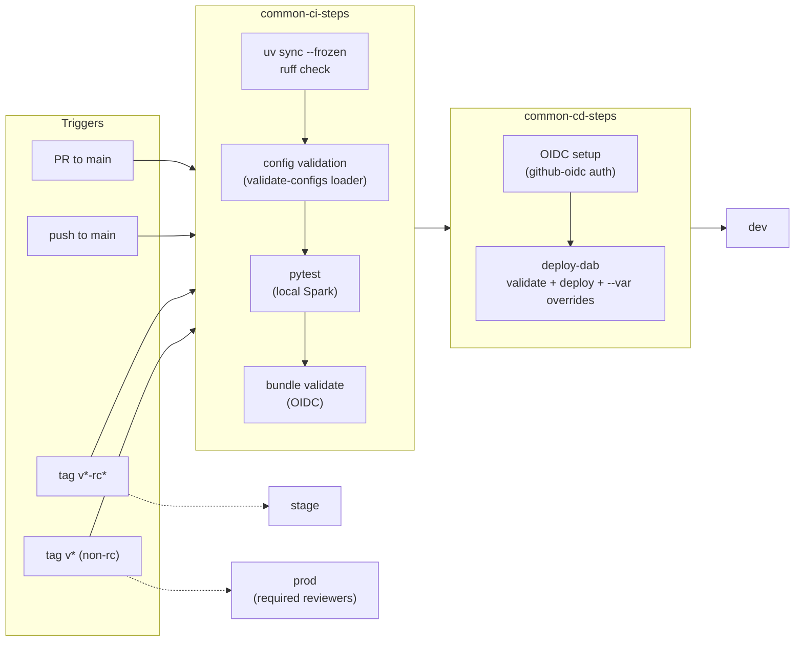
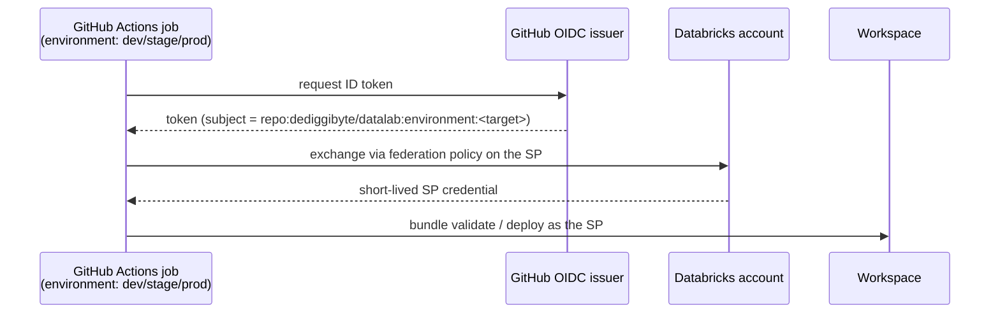
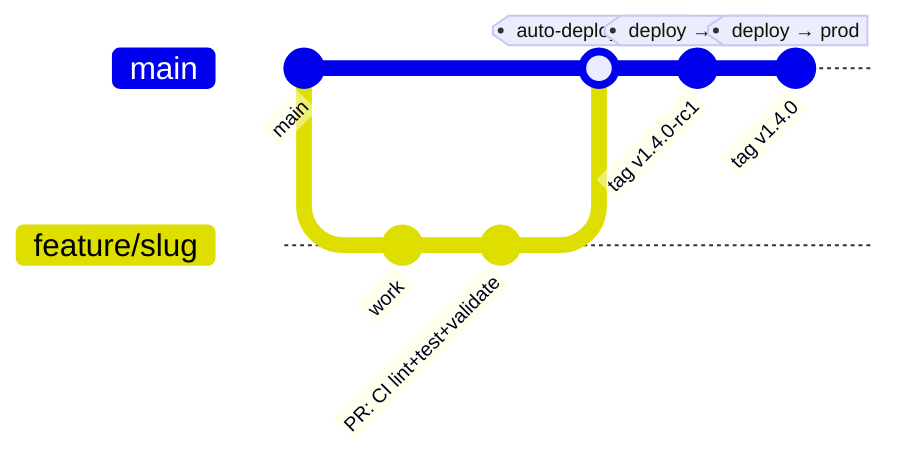

# CI/CD

[← README](../README.md) · [Architecture](ARCHITECTURE.md) · [Framework](FRAMEWORK.md) · **CI/CD** · [Migration](MIGRATION.md)

GitHub Actions + GitHub OIDC + Declarative Automation Bundles. No long-lived
Databricks secrets are stored in GitHub.

## Pipeline view



## Workflows

| Workflow | Trigger | What runs |
|---|---|---|
| `ci-cd-dev.yml` | PRs to `main`, pushes to `main`, manual | CI on PRs; CI + deploy to `dev` on push to main |
| `ci-cd-stage.yml` | `v*-rc*` tags, manual | CI + deploy to `stage` |
| `ci-cd-prod.yml` | `v*` tags (non-rc), manual | CI + deploy to `prod` |
| `pr-template-check.yml` | every PR | enforces the unified PR template |

Reusable pieces:

- `common-ci-steps.yml` — `uv sync --frozen` → `ruff check` (same paths as
  `make lint`, examples/ included) → config validation
  (`python -m datalab.framework`, the `make validate-configs` loader) →
  `pytest` (local Spark, Java 21; runs the framework suite AND the examples'
  suites) → `databricks bundle validate -t <target>` (OIDC).
- `common-cd-steps.yml` — OIDC setup → `deploy-dab` composite action
  (validate + deploy with optional `--var` overrides). **dev passes
  `auto-approve: true`** so CI can apply destructive changes (e.g. deleting a
  renamed pipeline and its STs/MVs) non-interactively — dev is
  `mode: development`, so a full refresh restores every ST/MV. `stage`/`prod`
  omit it (default `false`): a destructive plan there fails the deploy loudly for
  a human to review before any pipeline/table/volume is deleted.
- Composite actions: `.github/actions/databricks-setup` (CLI install +
  `~/.databrickscfg` with `auth_type = github-oidc`),
  `.github/actions/deploy-dab`.

## OIDC trust chain



## One-time setup per target

This repo deliberately reuses the **same workspace + OIDC service principal**
as the `klarna-access-agent` and `databricks_dqx_agent` repos:

- workspace: `https://dbc-425be768-f138.cloud.databricks.com`
- SP application ID: `437346a1-0b53-418a-80d4-abaf2586ed97`
  (`access-management-sp-rulebook`)

For each target (`dev`, `stage`, `prod`):

1. **Service principal** (Databricks Account Console → Service principals):
   the shared SP above; it needs permission to deploy bundles to the
   workspace (and CREATE/USE on the target catalog).
2. **Federation policy** on that service principal — one per target, because
   the subject embeds the repo and GitHub Environment:

   ```bash
   databricks account service-principal-federation-policy create <SP_NUMERIC_ID> --json '{
     "oidc_policy": {
       "issuer": "https://token.actions.githubusercontent.com",
       "audiences": ["<DATABRICKS_ACCOUNT_ID>"],
       "subject": "repo:dediggibyte/datalab:environment:<target>"
     }
   }'
   ```

   The subject is environment-style because the CI/CD jobs declare
   `environment: <target>`. If a deploy fails with `TOKEN_SUBJECT_INVALID` /
   `TOKEN_INVALID`, copy the exact subject/audience strings from the error
   into the policy.
3. **GitHub Environment** named exactly `<target>`
   (repo Settings → Environments):
   - secrets: `DATABRICKS_HOST`, `DATABRICKS_CLIENT_ID` (the SP application ID)
   - optional variables: `DATALAB_CATALOG`, `DATALAB_SALES_LANDING_PATH`
     (from `databricks.yml`), `DATALAB_READER_GROUP`, `DATALAB_ENGINEER_GROUP`
     (the group names from `rbac.yml`) — forwarded as `--var` overrides; empty
     → the committed `databricks.yml` / `rbac.yml` defaults
   - for `prod`: add required reviewers so deploys need approval.
   - Environments without secrets are skipped gracefully by the deploy gate
     (the merge stays green until stage/prod are provisioned).
4. **Unity Catalog bootstrap** (one time, before the first deploy):
   create the persona groups (`databricks groups create` or the account
   console — `dl_sales_readers`, `dl_sales_engineers` for stage/prod), then
   `make bootstrap-uc TARGET=<target> WAREHOUSE_ID=<sql-warehouse-id>` to
   create the catalog, medallion + landing/exports schemas, volumes, and
   GRANTs. Dry-run first by omitting `WAREHOUSE_ID`. The SP also needs
   CREATE/USE on the target catalog (step 1). Gotchas learned on the AWS
   workspace: UC grants need **account-level** groups (workspace-local SCIM
   groups are rejected) assigned to the workspace via
   `databricks account workspace-assignment update`; metastores without a
   storage root (Default Storage) need
   `--managed-location s3://.../unity-catalog/<workspace-id>` (match the
   workspace's existing catalogs).

## Release flow



Branching practice (AGENTS.md "Branching & releases"): every branch is cut
from a fresh `main` and named `feature/<slug>`, `fix/<slug>` or
`debug/<slug>`; one PR per branch. The repo setting **"Automatically delete
head branches"** is enabled so merged branches disappear from the remote —
prune locally with `git fetch --prune`, and re-apply the setting after a
repo recreation with:

```bash
gh repo edit --delete-branch-on-merge
```

## Retention & storage

GitHub auto-expires Actions **logs and artifacts** after a configurable
retention period — the only storage lever worth pulling here. Set it to **30
days**: repo Settings → Actions → General → "Artifact and log retention"
(there is no workflow-YAML knob for log retention and no documented repo-level
REST endpoint; org owners can cap it org-wide). It is forward-looking — logs
and artifacts already created keep their original expiry, so existing runs age
out on their old schedule.

Everything else is deliberately **not** auto-deleted: it costs ~nothing or is
already self-managing (measured June 2026 on the private `dediggibyte/datalab`):

| Item | Observed | Why it is left alone |
|---|---|---|
| Git history (commits) | repo ~7.5 MB, `.git` ~14 MB | Source of truth; `v*` / `v*-rc*` tags drive stage/prod and are the audit trail. Deleting commits = force-push history rewrite — destructive, breaks the release tags, and forbidden by the branch/safety rules (AGENTS.md). |
| Workflow artifacts | 0 (no `upload-artifact` steps) | Artifacts are the main *billable* Actions-storage item — and this repo uploads none. |
| Actions caches | ~2.73 GB / 6 (the `setup-uv` caches keyed on `uv.lock`) | **Free** — caches are not billable, are capped at 10 GB/repo, and auto-evict after 7 days unused. Self-managing. |
| Deployment records | metadata (~0) | Created by `environment:` on the CD jobs (one per deploy); pruning them is tidiness, not storage. |

If a hard cache cap is ever needed, add a scheduled (`cron`) workflow with
`permissions: actions: write` that deletes caches unused > 30 days — but the
7-day auto-evict usually makes this unnecessary.

## Local equivalents

CI and the Makefile run the same commands, so green locally ≈ green in CI:

```bash
make lint && make test && make validate
```
