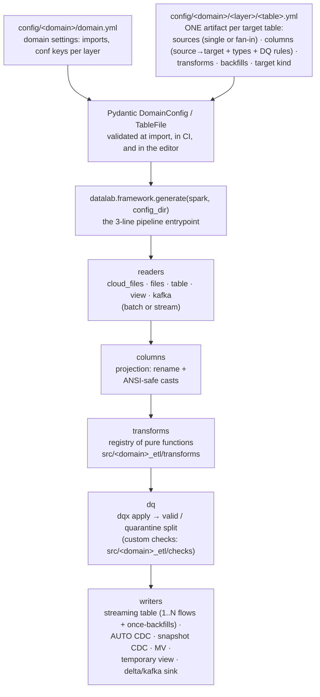
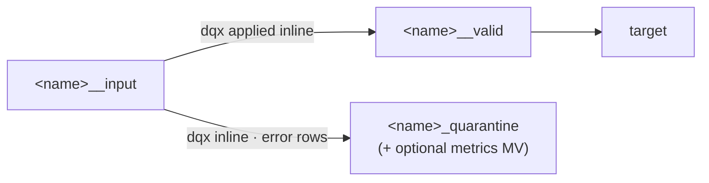
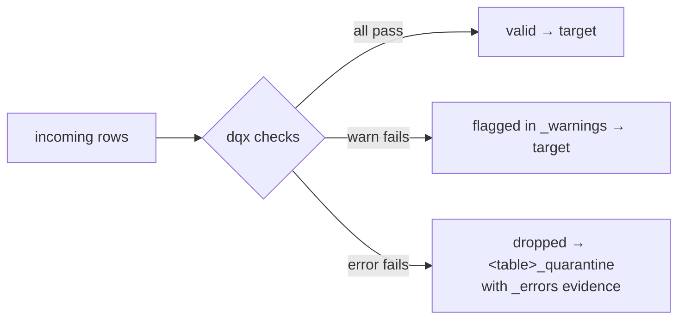
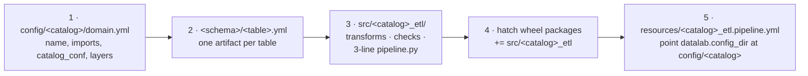
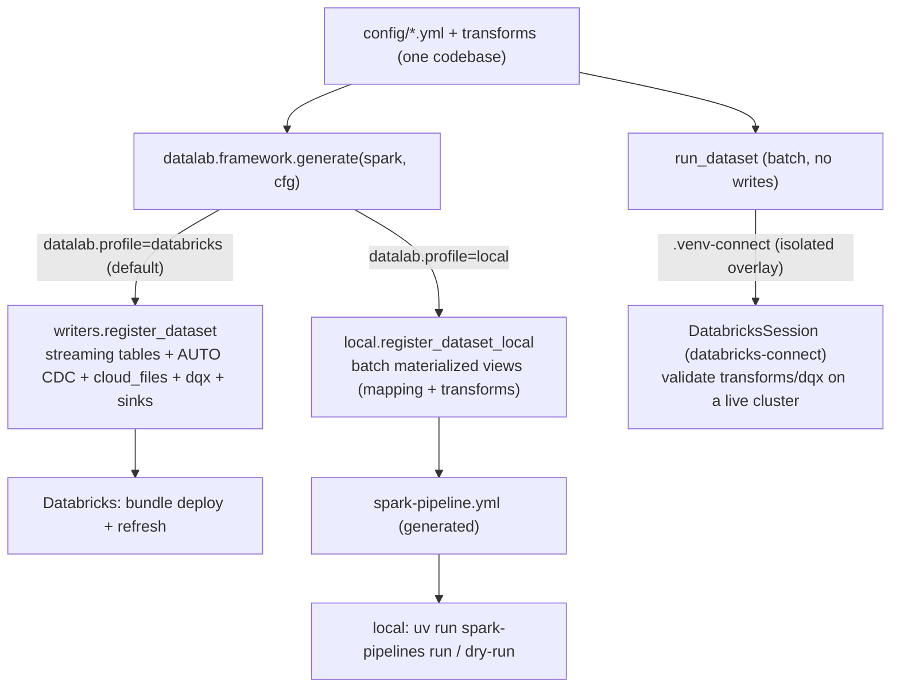

# The datalab framework (flowspec) — complete reference

[← README](../README.md) · [Architecture](ARCHITECTURE.md) · **Framework** · [CI/CD](CICD.md) · [Migration](MIGRATION.md)

The reusable LDP framework: every **target table is one YAML artifact**,
authored by hand or by a coding agent from a natural-language request (skill:
`author-ldp-artifact`), validated by Pydantic models, and generated into
Lakeflow Spark Declarative Pipelines (SDP) datasets through reader/writer
adapters. Data quality is
[databrickslabs/dqx](https://databrickslabs.github.io/dqx/) end to end.

New to the repo? Read [GETTING_STARTED.md](GETTING_STARTED.md) first — it
walks a new domain from empty folder to deployed pipeline. This page is the
reference you come back to.



Generated dataset graph per artifact:



dqx is applied **inline** when building `__valid` and the quarantine — not in a
separate `__checked` view they re-read. The `_errors`/`_warnings` result columns
must be produced and consumed in the same DataFrame scope: re-reading a checked
view by name (`spark.read[Stream].table`) drops them on Databricks SDP, failing
the split with `UNRESOLVED_COLUMN _errors`. (A `temporary_view` target carrying
quality is the one exception — it emits `__checked`, the annotated frame, as its
published output.)

**No hardcoded catalogs — ever.** Every location in an artifact is a
pipeline-conf KEY (`datalab.catalog`, `datalab.silver_schema`, …) resolved per
environment through bundle variables, so promoting dev → stage → prod never
edits a config file. In this repo the worked example lives at
`examples/customer_sales/config/customer_sales/`; in an adopter repo the same
tree sits at `config/<catalog>/`. Folder paths mirror the UC namespace —
`config/<catalog>/<schema>/<table>.yml` ⇒ `<catalog>.<schema>.<table>` — see
[NAMING.md](NAMING.md).

## The artifact, field by field

```yaml
# yaml-language-server: $schema=<relative path to>/schemas/table_config.schema.json
schema_version: 1
name: orders                  # == file name, == target table name
comment: One business-language line describing the table.

source: { ... }               # ONE source — OR `sources:` for fan-in (below)
sources: [ ... ]              #   mutually exclusive with `source:`
backfill: [ ... ]             # optional one-time historical loads (below)

columns:                      # target columns: source→target names + types + rules
  - name: order_id            #   target column name
    source: src_order_id      #   source column; omit when identical
    type: string              #   Spark type; casts are ANSI-safe (try_cast:
    comment: Business key.    #   malformed → NULL for DQ to flag, never a crash)
    quality:                  #   THIS column's dqx rules (auto-named, column injected)
      - criticality: error
        check: {function: is_not_null}

transform:                    # only logic a mapping can't express
  - function: sales.enrich_orders     # @transform-registered pure function
    args: {with_tax: true}            # extra kwargs, straight from YAML

quality:                      # table-level rules + quarantine/metrics settings
  checks: [ ... ]             #   multi-column / dataset-level dqx rules
  quarantine:                 #   error rules AUTO-quarantine even without this
    include_warnings: false
  metrics: {enabled: false}
  references: { ... }         #   batch ref tables for foreign_key/compare checks

target:
  kind: streaming_table       # streaming_table | materialized_view |
                              # temporary_view | delta_sink | kafka_sink
  # … kind-specific fields below
```

Validation runs at three stations: the editor (JSON schemas, regenerate with
`make schema`), `make validate-configs` (same loader CI and pytest use), and
pipeline import. A bad config never moves data.

## Sources (`source.kind`)

### `cloud_files` — streaming ingest from cloud storage (Auto Loader)

```yaml
source:
  kind: cloud_files
  path_conf: datalab.sales_landing_path   # conf KEY for the volume path
  format: json          # json|csv|parquet|avro|orc|text|xml|binaryFile
  options:              # full Auto Loader catalog, verbatim — quote YAML-1.1
    cloudFiles.inferColumnTypes: "true"   # ambiguous scalars ("true","no","1")
    cloudFiles.schemaEvolutionMode: addNewColumns
  schema_hints: "zip string, version int" # partial contract (cloudFiles.schemaHints)
  reader_schema: null   # full explicit DDL schema (skips inference entirely)
  add_lineage: true     # adds _ingest_ts + _source_file columns
```

SDP manages `schemaLocation` and checkpoints itself — never set them.

### `files` — BATCH read of files (for MVs and backfills)

```yaml
source: {kind: files, path_conf: datalab.history_dump, format: parquet}
# also: options: {...}, reader_schema: "id string, ..." ; format may be `delta`
```

Every refresh re-reads the location. For incremental ingest use `cloud_files`.

### `table` — Unity Catalog table, batch or streaming

```yaml
source:
  kind: table
  name: customers_raw
  layer: bronze          # resolves via domain.yml layers (preferred), or:
  # catalog_conf / schema_conf: explicit conf keys for cross-domain tables
  as_stream: true        # omit/false = batch read
  options:               # reader options, verbatim:
    skipChangeCommits: "true"   # REQUIRED to stream from an AUTO CDC/SCD
                                # target or any table taking updates/deletes
    # readChangeFeed: "true" + startingVersion: stream the change feed (the
    #   canonical way to consume an SCD table downstream)
    # versionAsOf / timestampAsOf: batch time travel
```

### `view` — a dataset defined earlier in the same pipeline

```yaml
source: {kind: view, name: orders_cleaned, as_stream: true}
```

### `kafka` — streaming from Kafka (and Kafka-compatible endpoints)

```yaml
source:
  kind: kafka
  bootstrap_servers_conf: datalab.kafka_brokers  # per-environment conf KEY
  topic: orders_in            # OR subscribe_pattern: "orders_.*"
  options:                    # auth/tuning verbatim: kafka.security.protocol,
    startingOffsets: earliest # kafka.sasl.*, maxOffsetsPerTrigger, …
```

The frame arrives with the Kafka wire schema (binary `key`/`value`, `topic`,
`partition`, `offset`, `timestamp`); decode in `columns:`/`transform:`.
Azure Event Hubs and AWS MSK work through their Kafka surfaces. Kinesis,
Pub/Sub and Pulsar are not yet config-expressible (see the capability matrix).

### `snapshot_function` — historical snapshot sets (snapshot CDC pattern B)

```yaml
source: {kind: snapshot_function, function: sales.customer_snapshots}
```

Only valid as the single source of a `streaming_table` +
`cdc_from_snapshot` target — see "Snapshot CDC" below.

## Fan-in: `sources:` (N flows → one streaming table)

The SDP replacement for `UNION`: one named append/CDC flow per entry keeps
the target incrementally updatable (a union would force full recompute), and
new sources can be added later without a full refresh.

```yaml
sources:
  - name: eu          # flow name — STABLE: it is the checkpoint identity;
    source: {kind: cloud_files, path_conf: datalab.eu_landing}   # renaming it
  - name: us          # abandons the checkpoint and reprocesses from scratch
    source: {kind: cloud_files, path_conf: datalab.us_landing}
target: {kind: streaming_table}
```

Rules: every entry must be streaming; valid for `streaming_table` (with or
without `cdc:` — multiple CDC flows into one target are allowed) and sink
targets; the `columns:`/`transform:`/`quality:` blocks apply to EVERY flow
(one table, one contract); each flow gets its own view chain and the
quarantine receives one flow per source.

## Backfills: `backfill:` (one-time once-flows)

```yaml
source: {kind: cloud_files, path_conf: datalab.landing}
backfill:
  - name: hist_2024          # flow name — stable, unique
    source: {kind: files, path_conf: datalab.history_2024, format: json}
    comment: 2024 archive, loaded once.
target: {kind: streaming_table}
```

Semantics (SDP `once=True` flows): runs ONE time, then idles in the graph as
an audit trail — and **re-runs automatically on a full refresh** to recreate
its slice. Leave the entry in the config after it completes; deleting it
deletes that data's recreation path. Make downstream logic robust to
duplicates, and bound the incremental source so it doesn't overlap the
backfill window. Split very large backfills into several entries (e.g. one
per year) for parallelism.

Rules: plain streaming tables take BATCH backfill sources (`files`, or
`table`/`view` without `as_stream`); CDC targets take STREAMING backfill
sources (SDP runs CDC once-flows over streaming reads); sinks and MVs take
no backfills (a full refresh never clears sink data; MVs recompute anyway).

Converting a single-source table to fan-in/backfill switches the generated
graph from the one-step `@dp.table` to an explicit target + named flows —
the primary flow's name changes, which means a new checkpoint. Pair the
change with a full refresh (you almost always want one then anyway).

## Targets (`target.kind`)

| Target kind | LDP objects | When |
|---|---|---|
| `streaming_table` | `dp.table`, or `dp.create_streaming_table` + N `append_flow`s | incremental ingest/append |
| `streaming_table` + `cdc:` | `create_streaming_table` + AUTO CDC flow(s) | upserts / SCD1 / SCD2 from a change feed |
| `streaming_table` + `cdc_from_snapshot:` | `create_streaming_table` + snapshot-CDC flow | SCD1/SCD2 from periodic FULL snapshots |
| `materialized_view` | `dp.materialized_view` | batch tables & aggregates (the default for "normal delta tables") |
| `temporary_view` | `dp.temporary_view` | pipeline-scoped views; quality is annotate-only |
| `delta_sink` | `dp.create_sink(delta)` + flow(s) | streaming append to EXTERNAL delta destinations |
| `kafka_sink` | `dp.create_sink(kafka)` + flow(s) | streaming publish to Kafka/Event Hubs/MSK |

Common `streaming_table` / `materialized_view` fields:

```yaml
target:
  kind: streaming_table
  schema: "id STRING NOT NULL, amount DECIMAL(12,2)"  # explicit DDL (optional)
  partition_cols: [day]            # XOR liquid clustering:
  cluster_by: [customer_id]        # liquid clustering keys
  cluster_by_auto: true            # automatic liquid clustering (may combine
                                   # with cluster_by as the initial keys)
  table_properties: {delta.enableChangeDataFeed: "true"}
```

`materialized_view` additionally takes `refresh_policy:
auto | incremental | incremental_strict | full` (SDP Beta; `incremental_strict`
fails instead of silently full-recomputing — SLA protection). MV
incrementalization also requires deterministic expressions — which is exactly
why the dq engine pins static `run_time`/`run_id` (see DQ semantics).

### AUTO CDC (`target.cdc`) — upserts/SCD from a change feed

```yaml
target:
  kind: streaming_table
  cdc:
    keys: [order_id]               # row identity
    sequence_by: _ingest_ts        # event order; LIST for tiebreaks:
    # sequence_by: [ts, seq_no]    #   becomes struct(ts, seq_no)
    scd_type: 1                    # 1 = upsert in place; 2 = history rows
    apply_as_deletes: operation = 'DELETE'    # condition → DELETE event
    apply_as_truncates: operation = 'TRUNCATE' # SCD1 only → full truncate
    column_list: [order_id, ts, v] # include-list … OR
    except_columns: [_rescued]     # … exclude-list (not both)
    ignore_null_updates: false     # true: NULLs in updates keep target values
    track_history_columns: []      # SCD2: only these open history rows … OR
    track_history_except_columns: [_ingest_ts]  # … all except these
```

SCD2 adds `__START_AT`/`__END_AT` (typed like `sequence_by`; current row has
`__END_AT IS NULL`) — an explicit `schema:` must declare both. `sequence_by`
must be sortable and never NULL. A CDC-fed table accepts ONLY CDC flows (SDP
rule — the framework rejects mixing); to stream FROM a CDC target
downstream, read its change feed (`options: {readChangeFeed: "true"}`) or
skip change commits.

### Snapshot CDC (`target.cdc_from_snapshot`) — SCD from full snapshots

For sources that deliver complete state each time (a nightly full dump, a
JDBC-extracted dimension): SDP diffs successive snapshots — new keys insert,
changed keys update, **keys absent from the newest snapshot delete**.

Pattern A — periodic snapshots, re-read on every pipeline update:

```yaml
source: {kind: table, name: customers_snapshot, layer: bronze}   # BATCH source
target:
  kind: streaming_table
  cdc_from_snapshot:
    keys: [customer_id]
    scd_type: 2
    # track_history_columns / track_history_except_columns as in cdc:
```

Columns/transforms/quality all apply (the prepared frame is the snapshot);
the quarantine materializes as an MV.

Pattern B — an historical snapshot SET walked version by version:

```yaml
source: {kind: snapshot_function, function: sales.customer_snapshots}
target:
  kind: streaming_table
  cdc_from_snapshot: {keys: [customer_id], scd_type: 2}
```

```python
from datalab.framework.registry import snapshot_source

@snapshot_source("sales.customer_snapshots")
def customer_snapshots(latest_version):
    """(latest processed version | None) -> (DataFrame, version) | None."""
    nxt = 1 if latest_version is None else latest_version + 1
    path = f"/Volumes/.../snapshots/v{nxt}"
    return (spark.read.parquet(path), nxt) if path_exists(path) else None
```

Columns/transforms apply (wrapped around the function); `quality:` rules are
rejected here — the engine consumes the function's frames whole, so there is
no stream to split into valid/quarantine. Validate snapshots upstream.

### Sinks (`delta_sink`, `kafka_sink`)

```yaml
target: {kind: delta_sink, table_conf: datalab.audit_table}   # or path_conf
# —
transform:
  - function: framework.to_json_value     # packs rows → JSON `value` (+ key)
    args: {key: order_id}
target:
  kind: kafka_sink
  bootstrap_servers_conf: datalab.kafka_brokers
  topic: orders_out          # omit to route via a per-row `topic` column
  options: {kafka.security.protocol: SASL_SSL}
```

Sinks are for EXTERNAL destinations only (ordinary batch tables →
`materialized_view`). The Kafka writer contract requires a `value` column
(string/binary) — `framework.to_json_value` builds it; `key`, `partition`,
`headers`, `topic` columns are optional. SDP caveats: a full refresh does
NOT clear sink data (reprocessed rows are appended), and sinks accept no
expectations — dqx still gates upstream in the framework's view chain.

## Data quality (dqx) semantics



- Rules are dqx metadata — anything from the
  [dqx checks reference](https://databrickslabs.github.io/dqx/docs/reference/quality_checks/)
  can be pasted in, including `filter:`, `for_each_column:`, and custom
  functions from `src/<catalog>_etl/checks/` (declared via `domain.yml`
  `imports:`). The NL→check-function mapping lives in the
  `author-ldp-artifact` skill and covers the full dqx catalog; pick the most
  specific function — `sql_expression`/`sql_query` are last resorts.
  Rule-shape conventions (auto `<column>_<function>` names, `criticality`
  defaulting to `error`) deliberately match the dqx rule-generator app
  (`databricks_dqx_agent`), so rules authored here and there are
  interchangeable dqx metadata.
- **Column-level rules** (`columns[].quality`) get `check.arguments.column`
  and a `<column>_<function>` rule name injected automatically. Table-level
  and multi-column rules go under `quality.checks` with explicit arguments.
- **Auto-quarantine**: any error-criticality rule creates
  `<table>_quarantine` even without a `quality.quarantine` block — rows are
  never silently dropped. Opt out explicitly with
  `quality: {quarantine: {enabled: false}}`.
- `criticality: error` rows never reach the target; they land in quarantine
  with `_errors` evidence structs. `criticality: warn` rows flow into the
  target (flagged in `_warnings` before result columns are stripped) and
  enter quarantine only when `quarantine.include_warnings: true`.
- Default `include_warnings: false` keeps the contract: quarantine ==
  exactly the dropped rows.
- `quality.metrics.enabled: true` adds a `<name>_dq_metrics` MV (per-rule
  violation counts); it requires `include_warnings: true`.
- Dataset-level rules (`is_unique`, `foreign_key`, `is_aggr_*`) are blocked
  on streaming targets (they'd validate per micro-batch); use a
  `materialized_view` target or opt in with
  `allow_streaming_dataset_checks: true`.
- The DQ engine pins static `run_time`/`run_id` overwrites — required to
  keep materialized views incrementalizable (non-deterministic expressions
  force full recompute). Don't change this; per-row event time belongs in
  the data (`_ingest_ts`).
- With multi-flow datasets, the same rules gate EVERY flow, and the shared
  quarantine receives one flow per source — the two sides can never diverge.

## SDP capability matrix

What the verified June-2026 SDP surface offers vs. what the YAML expresses.
"Deliberate" = excluded on purpose; the rationale is the row's note.

| SDP capability | YAML surface | Status |
|---|---|---|
| Auto Loader (all formats/options, schema hints, explicit schema) | `source.kind: cloud_files` | ✅ |
| Batch file reads in MVs | `source.kind: files` | ✅ |
| Table reads, batch + streaming, reader options (`skipChangeCommits`, CDF, time travel) | `source.kind: table` + `options:` | ✅ |
| Same-pipeline dataset reads | `source.kind: view` / `table` | ✅ |
| Kafka / Event Hubs / MSK source | `source.kind: kafka` | ✅ |
| Kinesis / Pub/Sub / Pulsar sources | — | Deliberate gap: add a source model or hand-write; the option surface is bus-specific |
| Streaming table (one-step `@dp.table`) | `target.kind: streaming_table` (single source) | ✅ legacy graph preserved |
| Explicit target + N append flows (fan-in, replaces UNION) | `sources:` list | ✅ |
| `once=True` backfill flows (incl. CDC once-flows) | `backfill:` list | ✅ |
| AUTO CDC SCD1/SCD2, full parameter set | `target.cdc` | ✅ (incl. truncates, column lists, struct sequence_by, track-history) |
| AUTO CDC FROM SNAPSHOT (periodic + historical sets) | `target.cdc_from_snapshot` (+ `snapshot_function` source) | ✅ |
| CDC-target exclusivity (only CDC flows; no snapshot+feed mixing) | validated | ✅ |
| Delta sink | `target.kind: delta_sink` | ✅ |
| Kafka sink (+ `framework.to_json_value`) | `target.kind: kafka_sink` | ✅ |
| Liquid clustering / auto clustering / partitioning / properties / comments / explicit schema | target fields | ✅ |
| MV `refresh_policy` (Beta) | `target.refresh_policy` | ✅ |
| `dp.expect_*` expectations | — | Deliberate: dqx owns quality (richer checks, quarantine evidence, one rules list for gate + quarantine) |
| Row filters / column masks in pipeline defs (Preview) | — | Deliberate: ABAC is display-only SQL under `sql/abac/`, admin-applied (see ARCHITECTURE.md) |
| `update_flow`, `foreach_batch_sink`, real-time mode (Preview) | — | Deliberate: Public Preview; revisit at GA |
| `private` tables, per-dataset `spark_conf`, external `path` | — | Deliberate: UC-managed everywhere; the framework's view chain covers intermediates |
| Custom Python data-source sinks (Preview) | — | Deliberate: Preview; `kafka_sink`/`delta_sink` cover the GA surface |

The local OSS `pyspark.pipelines` lacks the AUTO CDC functions and some
Databricks-only knobs (`once`, `cluster_by_auto`, `refresh_policy`);
`datalab.framework.compat` guards them — graph capture drops them locally
(shape only), the Databricks runtime gets them all, and anything else raises
an actionable error instead of an AttributeError. To actually RUN the medallion
off-Databricks, use the **local profile** (`make run-local`) — a batch
materialized-view downgrade of the same configs (no AUTO CDC dedup, no dqx, no
Auto Loader/sinks); see "Run anywhere — three execution profiles".

## Add a table — one artifact

Create `config/<catalog>/<schema>/<table>.yml` (file name == target table
name). Worked example with quality + CDC:
`examples/customer_sales/config/customer_sales/silver/customers.yml`. Then:

```bash
make validate-configs   # pydantic + static dqx validation; fix what it names
make test               # unit tests (local Spark)
# behavior, without deploying:
#   run_dataset in a test or notebook/REPL, or make validate-connect
make deploy run         # dev refresh — verifies the engine-owned parts (CDC)
```

If new logic is needed, register a pure function in the DOMAIN package and
list its module in `domain.yml` `imports:`:

```python
@transform("customer_sales.enrich_orders")
def enrich_orders(df: DataFrame, with_tax: bool = False) -> DataFrame: ...
```

Built-ins available without any python: `framework.add_lineage`,
`framework.select {columns}`, `framework.where {condition}`,
`framework.to_json_value {key}`.

## Add a domain — the framework is never edited



1. `config/<catalog>/domain.yml` — domain name (== base catalog name,
   [NAMING.md](NAMING.md)), `imports:`, `catalog_conf`, per-layer `layers:`
   schema conf keys.
2. `config/<catalog>/<schema>/<table>.yml` — one artifact per target table.
3. `src/<catalog>_etl/` — `transforms/` (pure `@transform` functions),
   `checks/` (custom dqx checks), `transformations/pipeline.py` (copy the
   3-line customer_sales one verbatim).
4. Add the domain package dir to `[tool.hatch.build.targets.wheel]` packages.
5. Copy `examples/customer_sales/resources/customer_sales_etl.pipeline.yml`
   (+ job yml), rename, point `datalab.config_dir` at the new config dir.

Full walkthrough: [GETTING_STARTED.md](GETTING_STARTED.md). The shipped
example to copy from:
[examples/customer_sales/](../examples/customer_sales/README.md).

## Verify before deploying

| Step | Command / file | Verifies |
|---|---|---|
| 1 | `make validate-configs` | Pydantic + static dqx validation of every domain |
| 2 | `make test` | unit tests on a local SparkSession |
| 3 | `datalab.framework.run_dataset(...)` (a test or notebook/REPL) | ONE dataset through the real framework path on sample or live data, no deploy — plan, valid rows, quarantine evidence, warnings. The same `run_dataset` API backs the unit tests, so it's literally the same code path; `run_dataset(..., flow="hist_2024")` previews a specific fan-in source or backfill entry |
| 4 | `datalab.framework.capture_graph(spark, config_dir)` | the full generated dataset/flow graph, locally (no Databricks) |
| 5 | `make run-local` / `make dry-run-local` | the whole medallion materialized (or just graph-validated) on sample data by the OSS `spark-pipelines` CLI — see "Run anywhere" below |
| 6 | `make validate-connect` | a dataset's mapping/transforms/dqx run on a LIVE cluster via isolated Databricks Connect (no deploy) |
| 7 | `make deploy run` | the engine-owned parts via a dev refresh — CDC caveat: the SCD merge itself is engine-owned; `run_dataset` verifies everything up to the valid/quarantine frames and prints the CDC plan |

## Run anywhere — three execution profiles

The same config-driven domain runs three ways. `datalab.profile` (a pipeline
`configuration` value, default `databricks`) selects the graph; the Databricks
deploy path is unchanged.



### 1. Local OSS run (`spark-pipelines`)

`make run-local` generates a `spark-pipeline.yml` (via
`python -m datalab.framework.local`) and runs it on local OSS Spark. The local
profile ([`src/datalab/framework/local.py`](../src/datalab/framework/local.py))
emits a **batch materialized-view** graph because OSS `pyspark.pipelines` lacks
the Databricks-only features. Fidelity caveats (all verified instead by `make
deploy run` / `make test`):

- **No AUTO CDC dedup.** OSS SDP eagerly analyzes window functions over an
  in-graph dataset and fails graph registration, and the SCD merge is
  engine-owned regardless — so a CDC target materializes the mapped/transformed
  rows **as-is** (expect duplicate keys locally).
- **No dqx gate.** dqx inspects `df.columns`/`df.isStreaming` while building
  checks, which OSS SDP forbids inside a query function — so no valid/quarantine
  split locally. Validate quality with `make test` / `run_dataset` /
  `make validate-connect`.
- **No Auto Loader / sinks.** `cloud_files` reads collapse to batch file reads;
  delta/kafka sinks are skipped.
- Datasets register under their **short name** (OSS SDP resolves cross-dataset
  reads via the pipeline's default catalog/database); generated artifacts
  (`spark-pipeline.local.yml`, `.build/`, `spark-warehouse/`) are git-ignored.

`make dry-run-local` runs `spark-pipelines dry-run` (syntax/analysis/graph
validation, no data) — the same step CI runs to guard the profile.

### 2. Databricks Connect validation (isolated)

`make validate-connect LAYER=<l> TABLE=<t>` runs `scripts/validate_connect.py`
against a **live cluster**: it builds a `DatabricksSession` and calls
`run_dataset` (mapping → transforms → dqx → valid/quarantine) on real UC data,
no deploy. databricks-connect conflicts with the dev `pyspark`, so it is
installed into a throwaway overlay (`uv run --no-project --with-editable . --with
databricks-connect`) and **never enters `uv.lock`**; pin `DBCONNECT` to your
workspace's DBR/serverless version. Pass the conf keys the dataset resolves via
`CONNECT_ARGS="--param datalab.catalog=… --param datalab.bronze_schema=…"`.

> **VS Code / Cursor Databricks extension — the "set up Python environment for
> Databricks Connect" error is EXPECTED.** The extension's *Python Environment*
> step installs/validates `databricks-connect` in the selected interpreter;
> pointed at the project `.venv` it fails with *"databricks-connect package is
> not installed in the current environment."* That is by design —
> `databricks-connect` is deliberately kept out of `.venv`/`uv.lock` (it
> conflicts with the dev `pyspark`, which owns the same namespace). That
> extension feature only powers interactive cell run/debug; it does **not** gate
> workspace sync, `bundle deploy`, or `bundle run`, so the error is advisory.
> Keep `.venv` as your interpreter and use `make validate-connect` (the overlay
> above) for live validation — do **not** "fix" it by installing
> `databricks-connect` into the project venv.

## Gotchas

- Quote YAML-1.1 ambiguous scalars in `options:` (`"true"`, `"no"`, `"1"`).
- One malformed YAML fails the whole domain pipeline at import — intended
  (fail fast before data moves); CI and `make validate-configs` catch it
  first.
- Flow names (fan-in `sources[].name`, `backfill[].name`) are checkpoint
  identities — renaming one reprocesses that flow from scratch.
- Streaming FROM a CDC/SCD table needs `options: {skipChangeCommits: "true"}`
  (or read the change feed); otherwise the downstream stream fails on the
  first UPDATE/DELETE commit.
- If a source already has `_errors`/`_warnings` columns, rename the result
  columns per layer: `dq: {result_columns: {errors: _dq_errors, warnings: _dq_warnings}}`.
- The editor autocompletes/validates configs via the `yaml-language-server`
  headers → `schemas/table_config.schema.json` and
  `schemas/domain_config.schema.json` (regenerate with `make schema` after
  model changes).
- dqx local execution is experimental upstream; the pinned behaviors we rely
  on are locked by `tests/unit/framework/test_dq.py`. Upgrade
  `databricks-labs-dqx` only after reading its changelog (it is Beta).
- Serverless/SDP runs ANSI SQL: a plain `.cast()` on malformed data fails
  the stream — the framework's `columns:` mapping always uses `try_cast`,
  so bad values become NULLs your quality rules then catch.
